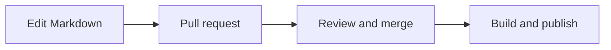

The wiki lives in [GitHub](https://github.com/hakermany-wiki/hakermany-wiki.github.io). Each article is a Markdown file. You can edit it entirely in the browser.

## Improve a page

1. Click **Edit page** at the bottom of the article.
2. Sign in to GitHub and edit the Markdown. Use the **Preview** tab to check it.
3. Create a branch and open a pull request describing the change.
4. After review and merge into `master`, GitHub Pages rebuilds the wiki automatically.

Maintainers with repository access can push changes directly. Contributors without write access can propose changes through a fork and pull request.



## Add an article

Create a file under `src/content/docs/` in the relevant chapter. Start with a title:

```md
---
title: Your article title
description: A short description of what the reader will learn.
---

Introduce the topic here.

## First section

Add explanations, examples and references.
```

Add the article to `astro.config.mjs` if the chapter uses a manually curated sidebar. Other chapters discover new pages automatically.

## Images and diagrams

Upload images to `public/images/` and link them with ``. Keep image sizes reasonable and provide descriptive alternative text.

Mermaid diagrams use a fenced code block with the language `mermaid`. They render in your browser without sending the diagram to an external service. Store PlantUML diagrams as local images and keep their source next to the article.

## Before publishing

Check links and formatting. Publish only content and images intended for everyone. The old Wiki.js revision history, accounts and private archive stay outside this repository.
